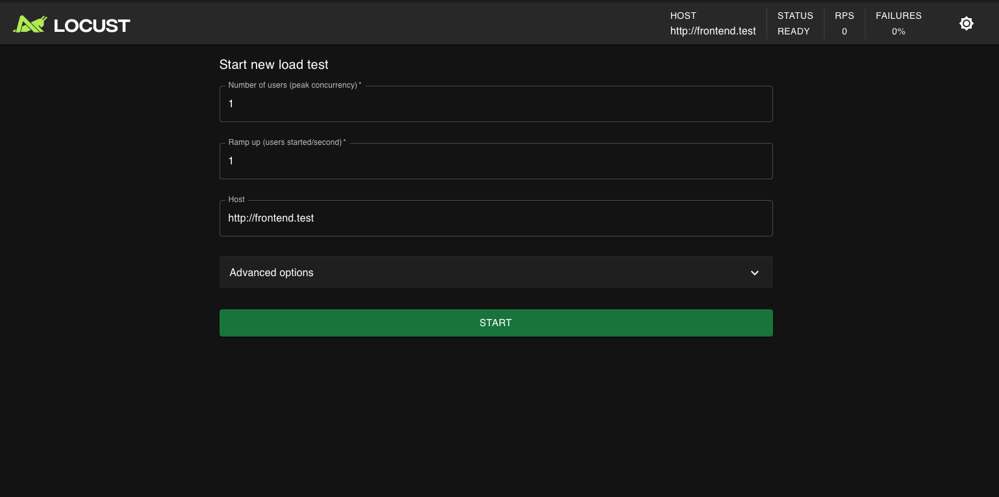

# Projeto 3 – Testes de Carga com Múltiplas Instâncias do WordPress Utilizando o Locust

Trabalho 3 da disciplina de Computação Distribuída (UNIFOR): realizar testes de carga com o **Locust** nas múltiplas instâncias do WordPress do Trabalho 2 (Nginx como balanceador de carga e Docker Compose), variando o número de instâncias e o número de usuários simultâneos.

## Equipe

| Nome | Matrícula |
|---|---|
| João Igor Vidal de Andrade | 2320296 |
| Raquel Albuquerque Quirino | 2320325 |
| Amanda Lira Andrade Botelho | 2320291 |

## Sobre o projeto

Teste de carga é a prática de simular vários usuários acessando um software ao mesmo tempo para medir o desempenho percebido pelo usuário final. Aqui o **Locust** gera a carga sobre três cenários de blog post (imagem de ~1 MB, texto de ~400 KB e imagem de ~300 KB), com 10, 100 e 1000 usuários simultâneos e com 1, 2 e 3 instâncias do WordPress: **27 execuções** no total. Os resultados são apresentados em gráficos, com usuários ou instâncias no eixo X e as métricas do Locust no eixo Y.

## Dispositivo de teste

Todos os testes foram executados em um único equipamento. O Locust, o Nginx, o WordPress e o MySQL rodaram na mesma máquina.

| Item | Valor |
|---|---|
| Dispositivo | **MacBook Air** (`Mac17,3`) |
| Processador | **Apple M5**, 10 núcleos (4 de desempenho + 6 de eficiência) |
| Memória | 16 GB |
| Sistema operacional | macOS 26.7.1 |
| Docker | Docker Desktop, engine 29.8.2 (`aarch64`) |
| Recursos da VM do Docker | 10 CPUs e ~7,75 GiB de memória |

## Arquitetura

Contêineres definidos em `docker-compose.yml`:

```
                          ┌──► wordpress (réplica 1) ──┐
Locust ──► nginx ─────────┼──► wordpress (réplica 2) ──┼──► mysql
                          └──► wordpress (réplica N) ──┘
```

| Contêiner | Imagem | Função |
|---|---|---|
| `locust` | `locustio/locust:2.32.0` | Gera a carga (interface web na porta 8089) |
| `nginx` | `nginx:1.19.0` | Recebe as requisições na porta 80 e as distribui entre os WordPress |
| `wordpress` (N réplicas) | `wordpress:5.4.2-php7.2-apache` | Instâncias da aplicação (padrão: 3) |
| `db` | `mysql:5.7` | Banco de dados único, compartilhado por todas as instâncias |

## Como foi feito

- **N instâncias do WordPress**: o serviço `wordpress` é replicável (`deploy.replicas: 3` por padrão). Para mudar: `docker compose up -d --scale wordpress=N`. Os IPs fixos do Trabalho 2 foram removidos, porque IP fixo impede replicar o serviço.
- **Nginx (`nginx.conf`)**: o `upstream` aponta para `wordpress:80`. O DNS interno do Docker devolve o IP de todas as réplicas e o Nginx distribui por **Round Robin**. O Nginx resolve o DNS só na inicialização, então é preciso reiniciá-lo (`docker compose restart nginx`) sempre que N mudar. O `X-Upstream` continua indicando qual instância respondeu.
- **Locust (`locust/locustfile.py`)**: usa a imagem oficial `locustio/locust`, e não a `grubykarol/locust` do enunciado, que é do tempo do Locust 0.x (Python 2). O cenário é escolhido pela variável `SCENARIO` (1, 2 ou 3). Cada usuário simulado pede o post e, em seguida, a imagem que está no HTML dele, como um navegador faria (o Locust não baixa imagens sozinho). Pausa de 1 a 3 s entre as ações.
- **Endereço do site**: o WordPress tem `siteurl=http://frontend.test`. O Nginx recebe esse nome como alias na rede do Docker e o Locust usa `LOCUST_HOST=http://frontend.test`. Com `localhost` o site responderia 301 e o teste mediria só redirecionamentos.
- **Posts dos cenários (`scripts/seed_posts.py`)**: cria os 3 posts pelo WP-CLI. As imagens são ruído aleatório (não comprimem), para o arquivo ter o tamanho pedido. A data do post é fixa, então os endereços são previsíveis (`/index.php/2026/01/01/<slug>/`).
- **Correção de DNS**: `RES_OPTIONS=single-request-reopen` nos WordPress evita um atraso de 5 s aleatório na conexão com o MySQL, causado por consultas DNS perdidas no Docker Desktop. Sem isso o teste mediria esse atraso.
- **Healthcheck**: o Nginx só sobe depois que todas as réplicas do WordPress estão saudáveis, para enxergar todas elas no DNS.
- **Automação (`scripts/run_all.py`)**: para cada número de instâncias, escala o WordPress, reinicia o Nginx e confere que todas recebem tráfego. Depois roda cada cenário e cada nível de usuários e grava um CSV em `results/`.
- **Gráficos (`scripts/plot.py`)**: lê os CSVs e gera as figuras em `graficos/`.

## Cenários de teste

| Cenário | Post | Conteúdo |
|---|---|---|
| 1 | `cenario-1-imagem-1mb` | imagem PNG de 999.507 bytes (~1 MB) |
| 2 | `cenario-2-texto-400kb` | texto de 400.000 caracteres (a página tem ~470 KB) |
| 3 | `cenario-3-imagem-300kb` | imagem PNG de 299.972 bytes (~300 KB) |

## Metodologia

- Usuários: **10, 100 e 1000**. Instâncias: **1, 2 e 3**. Cada combinação foi executada **uma vez**.
- Os usuários sobem em 10 s (spawn rate = usuários ÷ 10). Depois, **60 s medidos**. O período de subida é descartado (`--reset-stats`).
- Métricas, da linha `Aggregated` do Locust (post e imagem juntos): tempo médio de resposta, p95, requisições por segundo e taxa de falhas.
- **Banco de dados com a configuração padrão**: o MySQL 5.7 foi usado sem ajustes, com o limite padrão de **151 conexões simultâneas** (`max_connections = 151`), compartilhado por todas as instâncias do WordPress. Esse limite influenciou os resultados com 1000 usuários (ver a Análise).

## Interface web do Locust

O Locust tem uma interface web, que o contêiner `locust` expõe em `http://localhost:8089`. Nela se informa o número de usuários, o ramp up (usuários criados por segundo) e o host, e se acompanham estatísticas e gráficos ao vivo.



**Decidimos não usá-la nos testes do trabalho.** Eles foram executados no modo sem interface (`--headless`) pelo `scripts/run_all.py`, pelos motivos abaixo:

- **Reprodutibilidade**: são 27 execuções, e a automação garante os mesmos parâmetros em todas (usuários, ramp up de 10 s e 60 s medidos). Pela interface cada valor seria digitado e cada execução parada à mão.
- **Resultados em arquivo**: cada execução grava seu CSV em `results/`, de onde saem as tabelas e os gráficos.
- **Escalar entre as execuções**: o `run_all.py` muda o número de instâncias do WordPress, reinicia o Nginx e confere o balanceamento antes de cada grupo de testes.

A interface continua disponível para exploração e demonstração: o `locustfile.py` é o mesmo nos dois modos.

## Como executar

Adicione o domínio ao `/etc/hosts`:

```
127.0.0.1   frontend.test
```

Suba os contêineres (3 instâncias por padrão) e crie os posts dos cenários:

```bash
docker compose up -d
python3 scripts/seed_posts.py
```

Escolher o número de instâncias (reinicie o Nginx depois):

```bash
docker compose up -d --scale wordpress=N
docker compose restart nginx
```

Rodar o Locust pela interface web (`http://localhost:8089`; o cenário vem de `SCENARIO` no serviço `locust`):

```bash
docker compose up -d
```

Rodar a bateria completa (27 execuções, ~35 minutos) e gerar os gráficos:

```bash
python3 scripts/run_all.py                                            # CSVs em results/
python3 -m venv .venv && .venv/bin/pip install -r requirements.txt    # só na primeira vez
.venv/bin/python scripts/plot.py                                      # gráficos em graficos/
```

- `run_all.py` pula execuções que já têm CSV, então dá para interromper (Ctrl+C) e continuar. Use `--force` para refazer.
- Teste rápido: `python3 scripts/run_all.py --users 10 --instances 1 --scenarios 1 --duration 10`.
- Ao terminar, o script volta o WordPress para 3 instâncias.

## Containers em execução

```
NAME                   IMAGE                           STATUS                   PORTS
projeto3-db-1          mysql:5.7                       Up 5 seconds             3306/tcp, 33060/tcp
projeto3-locust-1      locustio/locust:2.32.0          Up Less than a second    0.0.0.0:8089->8089/tcp
projeto3-nginx-1       nginx:1.19.0                    Up Less than a second    0.0.0.0:80->80/tcp
projeto3-wordpress-1   wordpress:5.4.2-php7.2-apache   Up 4 seconds (healthy)   80/tcp
projeto3-wordpress-2   wordpress:5.4.2-php7.2-apache   Up 5 seconds (healthy)   80/tcp
projeto3-wordpress-3   wordpress:5.4.2-php7.2-apache   Up 4 seconds (healthy)   80/tcp
```

## Balanceamento de carga (Round Robin)

Seis requisições seguidas. O cabeçalho `X-Upstream` alterna entre os três IPs dos WordPress:

```bash
for i in $(seq 6); do curl -sI -H "Host: frontend.test" localhost/ | grep -i x-upstream; done
```

```
X-Upstream: 172.30.0.132:80
X-Upstream: 172.30.0.131:80
X-Upstream: 172.30.0.130:80
X-Upstream: 172.30.0.132:80
X-Upstream: 172.30.0.131:80
X-Upstream: 172.30.0.130:80
```

## Resultados

Cada figura tem dois painéis: **usuários** no eixo X (uma linha por número de instâncias) e **instâncias** no eixo X (uma linha por número de usuários). O **p95** é o tempo abaixo do qual ficam 95% das respostas, ou seja, mostra o que a maioria dos usuários sente nos piores momentos, sem ser distorcido por poucos casos extremos.

A figura de **distribuição de percentis** de cada cenário mostra a curva inteira: o eixo X é o percentil (50%, 90%, 95%, 99%, ..., 100% = a resposta mais lenta), o eixo Y é o tempo de resposta, há um painel por número de usuários e uma linha por número de instâncias. Uma curva que fica baixa e plana indica respostas rápidas e uniformes. Um "degrau" ou uma subida no final indica uma cauda de respostas lentas.

### Cenário 1 – post com imagem de ~1 MB


<details>
<summary>Tabela completa</summary>

| Usuários | Instâncias | Requisições | Falhas | Tempo médio (ms) | p95 (ms) | Req/s |
|---:|---:|---:|---:|---:|---:|---:|
| 10 | 1 | 588 | 0,0% | 15 | 39 | 9,8 |
| 10 | 2 | 592 | 0,0% | 15 | 39 | 9,8 |
| 10 | 3 | 605 | 0,0% | 15 | 38 | 10,0 |
| 100 | 1 | 6000 | 0,0% | 9 | 20 | 99,8 |
| 100 | 2 | 5975 | 0,0% | 11 | 25 | 99,4 |
| 100 | 3 | 6020 | 0,0% | 9 | 20 | 100,1 |
| 1000 | 1 | 30878 | 57,8% | 381 | 1600 | 513,5 |
| 1000 | 2 | 30957 | 65,2% | 321 | 1800 | 514,8 |
| 1000 | 3 | 29706 | 71,8% | 312 | 2200 | 493,6 |

</details>

### Cenário 2 – post com texto de ~400 KB


<details>
<summary>Tabela completa</summary>

| Usuários | Instâncias | Requisições | Falhas | Tempo médio (ms) | p95 (ms) | Req/s |
|---:|---:|---:|---:|---:|---:|---:|
| 10 | 1 | 303 | 0,0% | 42 | 59 | 5,1 |
| 10 | 2 | 295 | 0,0% | 40 | 58 | 4,9 |
| 10 | 3 | 290 | 0,0% | 41 | 59 | 4,8 |
| 100 | 1 | 2962 | 0,0% | 27 | 35 | 49,3 |
| 100 | 2 | 2974 | 0,0% | 25 | 34 | 49,5 |
| 100 | 3 | 2978 | 0,0% | 38 | 63 | 49,5 |
| 1000 | 1 | 23239 | 77,4% | 601 | 1900 | 386,1 |
| 1000 | 2 | 25531 | 84,5% | 358 | 2200 | 424,2 |
| 1000 | 3 | 25472 | 87,3% | 364 | 2600 | 423,2 |

</details>

### Cenário 3 – post com imagem de ~300 KB


<details>
<summary>Tabela completa</summary>

| Usuários | Instâncias | Requisições | Falhas | Tempo médio (ms) | p95 (ms) | Req/s |
|---:|---:|---:|---:|---:|---:|---:|
| 10 | 1 | 590 | 0,0% | 15 | 40 | 9,8 |
| 10 | 2 | 602 | 0,0% | 15 | 38 | 10,1 |
| 10 | 3 | 588 | 0,0% | 16 | 43 | 9,8 |
| 100 | 1 | 5966 | 0,0% | 9 | 22 | 99,2 |
| 100 | 2 | 5956 | 0,0% | 8 | 18 | 99,1 |
| 100 | 3 | 5966 | 0,0% | 9 | 19 | 99,3 |
| 1000 | 1 | 31086 | 56,8% | 377 | 1500 | 514,5 |
| 1000 | 2 | 32809 | 55,0% | 307 | 1500 | 545,5 |
| 1000 | 3 | 32391 | 57,3% | 283 | 1600 | 538,5 |

</details>

## Análise

**Até 100 usuários o sistema não sofre, e o número de instâncias não faz diferença.** Não houve nenhuma falha e o tempo médio ficou entre 8 e 42 ms. As diferenças entre 1, 2 e 3 instâncias são de poucos milissegundos, dentro da variação esperada de uma única execução. As requisições por segundo seguem o que os usuários geram (com pausa média de 2 s, 100 usuários produzem ~50 ciclos por segundo, ou ~100 req/s com imagem e ~50 req/s no cenário de texto), e não o que o servidor consegue atender. Uma instância já dá conta dessa carga.

**O cenário 2 (texto de 400 KB) é o mais lento por requisição.** Com 100 usuários e 3 instâncias, o post de texto leva ~38 ms, enquanto o post dos cenários 1 e 3 leva ~16 ms (a página tem ~60 KB) e a imagem apenas 1,5 a 2,2 ms. Nos cenários 1 e 3 a média agregada mistura post e imagem, e a imagem é muito rápida, o que reduz a média. Entre as imagens de 1 MB e 300 KB a diferença é mínima, porque o tráfego é local, sem rede real. O custo está em gerar a página (PHP + banco), não em transferir o arquivo.

**Com 1000 usuários o sistema falha, e adicionar instâncias não resolve.** As falhas ficaram entre 55% e 87% e o p95 subiu para 1,5 a 2,6 s. A taxa de falhas **não diminuiu** com mais instâncias em nenhum cenário. No cenário 1 subiu de 57,8% para 65,2% e 71,8%. No cenário 2, de 77,4% para 84,5% e 87,3%. No cenário 3 ficou estável, entre 55% e 57%.

**A causa identificada é o limite de conexões do MySQL, compartilhado por todas as instâncias.**

- Quase todas as falhas são `HTTP 500` no **post**. No cenário 1 com 3 instâncias: 21.334 falhas em 25.520 pedidos do post, contra 0 falhas em 4.186 pedidos da imagem. A imagem é servida direto do disco pelo Apache e não usa o banco.
- O MySQL está com `max_connections = 151` (padrão). Depois da execução com 3 instâncias ele registrava `Connection_errors_max_connections = 19.121` e `Max_used_connections = 152`: o limite foi atingido e conexões foram recusadas.
- O log do Apache também registrou `server reached MaxRequestWorkers` (limite padrão de 150 processos por instância).
- Mais instâncias significam mais processos tentando abrir conexões contra o **mesmo** limite do banco.

O **tempo médio** com 1000 usuários mistura respostas de erro, que são rápidas, com respostas bem-sucedidas, que são lentas. Por isso o p95 descreve melhor o que o usuário sente.

A **distribuição de percentis** com 1000 usuários mostra isso: nas execuções com 2 e 3 instâncias, até cerca de 80% das respostas levam ~100 ms ou menos, e a partir daí a curva dispara para 1,5 a 4 s. Esse degrau é coerente com a maioria das respostas serem erros rápidos, com as demais formando a cauda lenta, mas essa leitura não foi verificada resposta a resposta. Com 10 e 100 usuários as curvas ficam baixas e próximas.

**Pico isolado no percentil 99,9 (cenário 1, 100 usuários, 2 instâncias):** nessa execução o 0,1% mais lento chegou a ~290 ms (máximo de 320 ms), contra ~52 ms com 1 instância e ~94 ms com 3 instâncias. Mas esse 0,1% são apenas **6 requisições** em ~6.000, todas do post (as imagens ficaram em 66 ms no pior caso), e não houve nenhuma falha. A causa não pode ser determinada com estes dados: pode ser uma instância num momento ruim, uso de CPU do próprio Mac, o MySQL emulado ou o Locust disputando CPU na mesma máquina. Como cada combinação foi executada uma única vez, não dá para saber se o pico é típico de 2 instâncias ou acaso, e ele **não indica que 3 instâncias sejam melhores que 2**. Para confirmar seria preciso repetir a execução várias vezes.

## Limitações

- **Uma execução por combinação**: não há repetição nem medida de variação. Diferenças de poucos milissegundos não devem ser lidas como ganho ou perda reais.
- **Tudo na mesma máquina**: o Locust compete por CPU com o Nginx, o WordPress e o MySQL, e o tráfego é local, sem latência de rede.
- **MySQL emulado**: a imagem `mysql:5.7` não tem versão ARM e roda como `linux/amd64` com emulação no Apple M5, o que pode torná-lo mais lento do que num servidor x86.
- **VM do Docker**: 10 CPUs e ~7,75 GiB de memória, compartilhados por todos os contêineres.
- **Conteúdo sintético**: as imagens são ruído aleatório e o texto é "lorem ipsum" repetido.
- **Métricas agregadas**: os tempos usam a linha `Aggregated` (post + imagem). Os CSVs em `results/` também têm as linhas separadas `post` e `imagem`.

## Conclusão

A camada da aplicação escala horizontalmente: o Nginx distribui as requisições por Round Robin entre as réplicas do WordPress, e o número de instâncias é configurável com `--scale`. Mas o desempenho total é limitado pelo componente compartilhado, o banco de dados. Nos três cenários, escalar o WordPress de 1 para 3 instâncias não trouxe ganho mensurável, e a carga de 1000 usuários mediu o limite de conexões do MySQL, e não o ganho de ter mais instâncias. Melhorias possíveis, não testadas aqui: aumentar `max_connections` do MySQL, usar cache de página ou de objetos e usar réplicas de leitura.
