# Projeto 3 – Testes de Carga com Múltiplas Instâncias do WordPress Utilizando o Locust

Trabalho 3 da disciplina de Computação Distribuída (UNIFOR): realizar testes de carga com o **Locust** nas múltiplas instâncias do WordPress do Trabalho 2 (Nginx como balanceador de carga e Docker Compose), variando o número de instâncias e o número de usuários simultâneos.

## Equipe

| Nome | Matrícula |
|---|---|
| João Igor Vidal de Andrade | 2320296 |
| Raquel Albuquerque Quirino | 2320325 |
| Amanda Lira Andrade Botelho | 2320291 |

## Sobre o projeto

Teste de carga é a prática de simular vários usuários acessando um software ao mesmo tempo para medir o desempenho percebido pelo usuário final. Aqui o **Locust** gera a carga sobre três cenários de blog post (imagem de ~1 MB, texto de ~400 KB e imagem de ~300 KB), com 10, 100 e 1000 usuários simultâneos e com 1, 2 e 3 instâncias do WordPress: **27 execuções** no total. Os resultados são apresentados em gráficos, com usuários ou instâncias no eixo X e as métricas do Locust no eixo Y.

## Dispositivo de teste

Todos os testes foram executados em um único equipamento. O Locust, o Nginx, o WordPress e o MySQL rodaram na mesma máquina.

| Item | Valor |
|---|---|
| Dispositivo | **MacBook Air** (`Mac17,3`) |
| Processador | **Apple M5**, 10 núcleos (4 de desempenho + 6 de eficiência) |
| Memória | 16 GB |
| Sistema operacional | macOS 26.7.1 |
| Docker | Docker Desktop, engine 29.8.2 (`aarch64`) |
| Recursos da VM do Docker | 10 CPUs e ~7,75 GiB de memória (`docker info`; o painel do Docker Desktop mostra 7,57 GB) |

## Arquitetura

Contêineres definidos em `docker-compose.yml`:

```
                          ┌──► wordpress (réplica 1) ──┐
Locust ──► nginx ─────────┼──► wordpress (réplica 2) ──┼──► mysql
                          └──► wordpress (réplica N) ──┘
```

| Contêiner | Imagem | Função |
|---|---|---|
| `locust` | `locustio/locust:2.32.0` | Gera a carga (interface web na porta 8089) |
| `nginx` | `nginx:1.19.0` | Recebe as requisições na porta 80 e as distribui entre os WordPress |
| `wordpress` (N réplicas) | `wordpress:5.4.2-php7.2-apache` | Instâncias da aplicação (padrão: 3) |
| `db` | `mysql:5.7` | Banco de dados único, compartilhado por todas as instâncias |

## Como foi feito

- **N instâncias do WordPress**: o serviço `wordpress` é replicável (`deploy.replicas: 3` por padrão). Para mudar: `docker compose up -d --scale wordpress=N`. Os IPs fixos do Trabalho 2 foram removidos, porque IP fixo impede replicar o serviço.
- **Nginx (`nginx.conf`)**: o `upstream` aponta para `wordpress:80`. O DNS interno do Docker devolve o IP de todas as réplicas e o Nginx distribui por **Round Robin**. O Nginx resolve o DNS só na inicialização, então é preciso reiniciá-lo (`docker compose restart nginx`) sempre que N mudar. O `X-Upstream` continua indicando qual instância respondeu.
- **Locust (`locust/locustfile.py`)**: usa a imagem oficial `locustio/locust`, e não a `grubykarol/locust` do enunciado, que é do tempo do Locust 0.x (Python 2). O cenário é escolhido pela variável `SCENARIO` (1, 2 ou 3). Cada usuário simulado pede o post e, em seguida, a imagem que está no HTML dele, como um navegador faria (o Locust não baixa imagens sozinho). Pausa de 1 a 3 s entre as ações.
- **Endereço do site**: o WordPress tem `siteurl=http://frontend.test`. O Nginx recebe esse nome como alias na rede do Docker e o Locust usa `LOCUST_HOST=http://frontend.test`. Com `localhost` o site responderia 301 e o teste mediria só redirecionamentos.
- **Posts dos cenários (`scripts/seed_posts.py`)**: cria os 3 posts pelo WP-CLI. As imagens são ruído aleatório (não comprimem), para o arquivo ter o tamanho pedido. A data do post é fixa, então os endereços são previsíveis (`/index.php/2026/01/01/<slug>/`).
- **Correção de DNS**: `RES_OPTIONS=single-request-reopen` nos WordPress evita um atraso de 5 s aleatório na conexão com o MySQL, causado por consultas DNS perdidas no Docker Desktop. Sem isso o teste mediria esse atraso.
- **Healthcheck**: o Nginx só sobe depois que todas as réplicas do WordPress estão saudáveis, para enxergar todas elas no DNS.
- **Automação (`scripts/run_all.py`)**: para cada número de instâncias, escala o WordPress, reinicia o Nginx e confere que todas recebem tráfego. Depois roda cada cenário e cada nível de usuários e grava um CSV em `results/`.
- **Gráficos (`scripts/plot.py`)**: lê os CSVs e gera as figuras em `graficos/`.

## Cenários de teste

| Cenário | Post | Conteúdo |
|---|---|---|
| 1 | `cenario-1-imagem-1mb` | imagem PNG de 999.507 bytes (~1 MB) |
| 2 | `cenario-2-texto-400kb` | texto de 400.000 caracteres (a página tem ~470 KB) |
| 3 | `cenario-3-imagem-300kb` | imagem PNG de 299.972 bytes (~300 KB) |

## Metodologia

- Usuários: **10, 100 e 1000**. Instâncias: **1, 2 e 3**. Cada combinação foi executada **uma vez**.
- Os usuários sobem em 10 s (spawn rate = usuários ÷ 10). Depois, **60 s medidos**. O período de subida é descartado (`--reset-stats`).
- Métricas, da linha `Aggregated` do Locust (post e imagem juntos): tempo médio de resposta, p95, requisições por segundo e taxa de falhas.
- **Banco de dados com a configuração padrão**: o MySQL 5.7 foi usado sem ajustes, com o limite padrão de **151 conexões simultâneas** (`max_connections = 151`), compartilhado por todas as instâncias do WordPress. Esse limite influenciou os resultados com 1000 usuários (ver a Análise).

## Interface web do Locust

O Locust tem uma interface web, que o contêiner `locust` expõe em `http://localhost:8089`. Nela se informa o número de usuários, o ramp up (usuários criados por segundo) e o host, e se acompanham estatísticas e gráficos ao vivo.


**Decidimos não usá-la nos testes do trabalho.** Eles foram executados no modo sem interface (`--headless`) pelo `scripts/run_all.py`, pelos motivos abaixo:

- **Reprodutibilidade**: são 27 execuções, e a automação garante os mesmos parâmetros em todas (usuários, ramp up de 10 s e 60 s medidos). Pela interface cada valor seria digitado e cada execução parada à mão.
- **Resultados em arquivo**: cada execução grava seu CSV em `results/`, de onde saem as tabelas e os gráficos.
- **Escalar entre as execuções**: o `run_all.py` muda o número de instâncias do WordPress, reinicia o Nginx e confere o balanceamento antes de cada grupo de testes.

A interface continua disponível para exploração e demonstração: o `locustfile.py` é o mesmo nos dois modos.

## Como executar

Adicione o domínio ao `/etc/hosts`:

```
127.0.0.1   frontend.test
```

Suba os contêineres (3 instâncias por padrão) e crie os posts dos cenários:

```bash
docker compose up -d
python3 scripts/seed_posts.py
```

Escolher o número de instâncias (reinicie o Nginx depois):

```bash
docker compose up -d --scale wordpress=N
docker compose restart nginx
```

Rodar o Locust pela interface web (`http://localhost:8089`; o cenário vem de `SCENARIO` no serviço `locust`):

```bash
docker compose up -d
```

Rodar a bateria completa (27 execuções, ~35 minutos) e gerar os gráficos:

```bash
python3 scripts/run_all.py                                            # CSVs em results/
python3 -m venv .venv && .venv/bin/pip install -r requirements.txt    # só na primeira vez
.venv/bin/python scripts/plot.py                                      # gráficos em graficos/
```

- `run_all.py` pula execuções que já têm CSV, então dá para interromper (Ctrl+C) e continuar. Use `--force` para refazer.
- Teste rápido: `python3 scripts/run_all.py --users 10 --instances 1 --scenarios 1 --duration 10`.
- Ao terminar, o script volta o WordPress para 3 instâncias.

## Containers em execução

```
NAME                   IMAGE                           STATUS                   PORTS
projeto3-db-1          mysql:5.7                       Up 5 seconds             3306/tcp, 33060/tcp
projeto3-locust-1      locustio/locust:2.32.0          Up Less than a second    0.0.0.0:8089->8089/tcp
projeto3-nginx-1       nginx:1.19.0                    Up Less than a second    0.0.0.0:80->80/tcp
projeto3-wordpress-1   wordpress:5.4.2-php7.2-apache   Up 4 seconds (healthy)   80/tcp
projeto3-wordpress-2   wordpress:5.4.2-php7.2-apache   Up 5 seconds (healthy)   80/tcp
projeto3-wordpress-3   wordpress:5.4.2-php7.2-apache   Up 4 seconds (healthy)   80/tcp
```

## Docker Desktop

Painel do Docker Desktop com os 7 contêineres do projeto: as 3 réplicas do WordPress, o Nginx, o MySQL e o Locust.

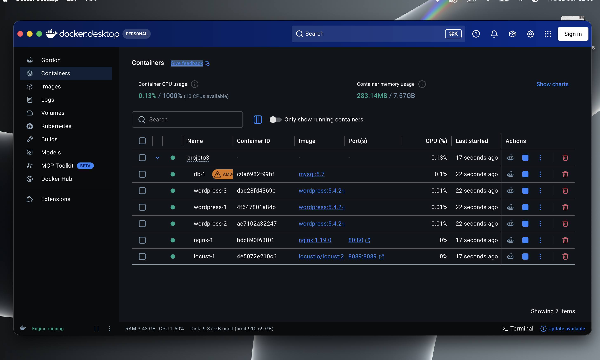

O selo **AMD** ao lado do `db-1` indica que o MySQL roda como `linux/amd64`, emulado no processador ARM do Mac (ver Limitações).

## Website funcionando

Acesso em `http://frontend.test`. A página inicial lista os posts dos cenários; na imagem, o post do cenário 3 (imagem de ~300 KB).


## Balanceamento de carga (Round Robin)

Seis requisições seguidas. O cabeçalho `X-Upstream` alterna entre os três IPs dos WordPress:

```bash
for i in $(seq 6); do curl -sI -H "Host: frontend.test" localhost/ | grep -i x-upstream; done
```

```
X-Upstream: 172.30.0.132:80
X-Upstream: 172.30.0.131:80
X-Upstream: 172.30.0.130:80
X-Upstream: 172.30.0.132:80
X-Upstream: 172.30.0.131:80
X-Upstream: 172.30.0.130:80
```

## Resultados

Cada gráfico (exceto o de percentis) tem dois painéis: **usuários** no eixo X (uma linha por número de instâncias) e **instâncias** no eixo X (uma linha por número de usuários). Abaixo de cada gráfico está a análise do que ele mostra. Os tempos de "post" e de "imagem" citados vêm das linhas separadas dos CSVs de `results/`.

O **p95** é o tempo abaixo do qual ficam 95% das respostas, ou seja, mostra o que a maioria dos usuários sente nos piores momentos, sem ser distorcido por poucos casos extremos.

A figura de **distribuição de percentis** mostra a curva inteira: o eixo X é o percentil (50%, 90%, 95%, 99%, ..., 100% = a resposta mais lenta), o eixo Y é o tempo de resposta, há um painel por número de usuários e uma linha por número de instâncias. A curva sempre sobe da esquerda para a direita, porque os tempos estão ordenados do mais rápido ao mais lento. O que importa é onde e quanto ela sobe: uma curva baixa e plana indica respostas rápidas e uniformes, e um "degrau" ou uma subida no final indica uma cauda de respostas lentas.

### Cenário 1 – post com imagem de ~1 MB

#### Tempo médio de resposta

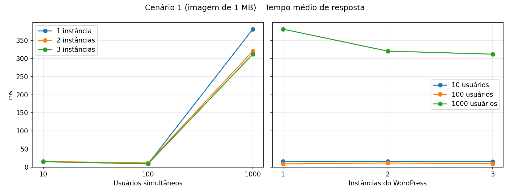

Com 10 e 100 usuários as três linhas ficam praticamente sobrepostas (9 a 15 ms): o número de instâncias não mudou o tempo médio. Essa média mistura as duas requisições de cada visita, o post (16 a 28 ms) e a imagem de 1 MB (2 a 3 ms), e por isso é baixa. O tempo é maior com 10 usuários (15 ms) do que com 100 (9 ms), o contrário do que se esperaria; a causa não foi determinada (uma hipótese é que processos do Apache/PHP e caches fiquem mais "aquecidos" com tráfego contínuo). Com 1000 usuários a média sobe para 312 a 381 ms e **cai** com mais instâncias (381, 321 e 312 ms). Isso não é melhora: é coerente com a média misturar erros `HTTP 500`, que são rápidos, e as falhas subirem de 58% para 72% (gráfico de falhas). Para 1000 usuários o p95 é mais confiável.

#### Percentil 95 (p95)

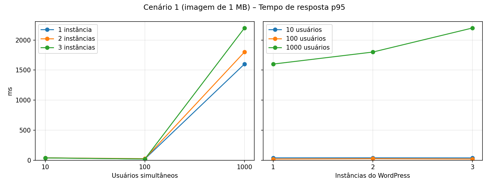

Com 10 usuários o p95 é de 38 a 39 ms (95% das respostas levaram até ~39 ms) e com 100 usuários cai para 20 a 25 ms. Com 1000 usuários salta para 1.600 ms (1 instância), 1.800 ms (2) e 2.200 ms (3): os 5% mais lentos esperam de 1,6 a 2,2 s, e **mais instâncias pioram esse valor**. No painel da direita, a linha de 1000 usuários sobe com as instâncias, enquanto as de 10 e 100 usuários ficam planas na base.

#### Requisições por segundo

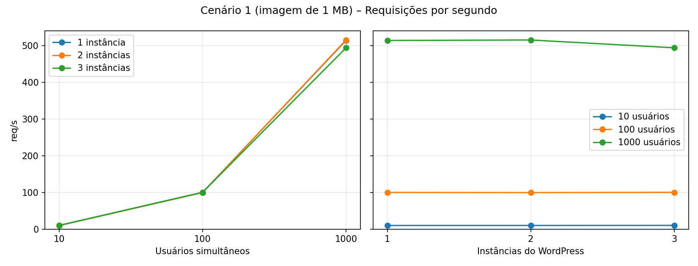

A vazão acompanha os usuários até 100: ~10 req/s com 10 usuários e ~100 req/s com 100 usuários, nas três arquiteturas. É o que os usuários geram (cada um faz uma visita a cada ~2 s, com 2 requisições: post e imagem), e não o limite do servidor. Com 1000 usuários a vazão fica em 494 a 515 req/s: 10× mais usuários deram só ~5× mais req/s, sinal de saturação. O número de instâncias não aumentou a vazão (514, 515 e 494 req/s com 1, 2 e 3 instâncias). Parte da diferença para o esperado (~1.000 req/s) vem de o Locust não pedir a imagem quando o post falha.

#### Taxa de falhas

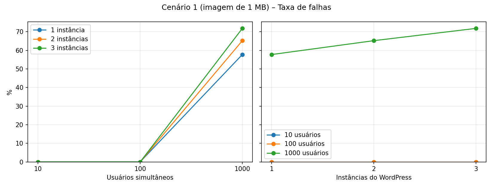

Não houve falhas até 100 usuários. Com 1000 usuários a taxa agregada é de 57,8% (1 instância), 65,2% (2) e 71,8% (3): **aumenta com mais instâncias**. Essa taxa é diluída pelas imagens, que quase não falham. Olhando só o post, a falha é de 73,5%, 79,2% e 83,6% (com 3 instâncias, por exemplo, 21.334 falhas em 25.520 pedidos do post, contra 0 falhas em 4.186 pedidos da imagem). Os erros são `HTTP 500` do WordPress, causados pelo limite de conexões do MySQL (ver a Análise geral): como o banco é compartilhado, mais instâncias significam mais processos disputando as mesmas 151 conexões.

#### Distribuição de percentis

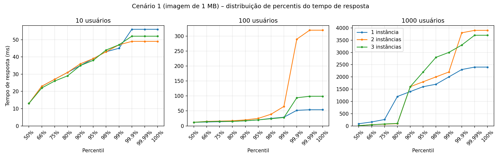

**10 usuários:** a curva sobe de ~13 ms (mediana) para 45 a 47 ms no percentil 99, e o máximo fica entre 49 e 56 ms; 99% das respostas levaram até ~47 ms nas três arquiteturas. Com só ~600 requisições, o percentil 99,9 e o máximo são praticamente a mesma requisição.

**100 usuários:** as curvas ficam baixas e próximas (até o percentil 98, todas em até 39 ms). A exceção é o final da linha de 2 instâncias: o percentil 99,9 chega a 290 ms (máximo de 320 ms), contra 52 ms com 1 instância e 94 ms com 3. Esse 0,1% são apenas 6 requisições em ~6.000, todas do post (as imagens ficaram em até 66 ms), sem nenhuma falha. A causa não pode ser determinada com estes dados. O mesmo padrão (percentil 99,9 maior com 2 instâncias) aparece de forma mais fraca nos cenários 2 e 3 com 100 usuários, então pode não ser só acaso, mas, com uma única execução por combinação, não dá para afirmar. Ele também não indica que 3 instâncias sejam melhores que 2.

**1000 usuários:** a curva tem um degrau. Com 2 e 3 instâncias a mediana é de 7 a 10 ms e até o percentil 80 as respostas ficam em ~100 ms ou menos, mas no percentil 90 já são 1.600 ms, e o máximo chega a 3,7 e 3,9 s. Com 1 instância a subida começa mais cedo (mediana de 88 ms e percentil 80 em 1.200 ms). A parte rápida da curva é coerente com os erros `HTTP 500` serem respostas rápidas (65 a 72% das requisições falharam nessas execuções), mas isso não foi verificado resposta por resposta.

<details>
<summary>Tabela completa</summary>

| Usuários | Instâncias | Requisições | Falhas | Tempo médio (ms) | p95 (ms) | Req/s |
|---:|---:|---:|---:|---:|---:|---:|
| 10 | 1 | 588 | 0,0% | 15 | 39 | 9,8 |
| 10 | 2 | 592 | 0,0% | 15 | 39 | 9,8 |
| 10 | 3 | 605 | 0,0% | 15 | 38 | 10,0 |
| 100 | 1 | 6000 | 0,0% | 9 | 20 | 99,8 |
| 100 | 2 | 5975 | 0,0% | 11 | 25 | 99,4 |
| 100 | 3 | 6020 | 0,0% | 9 | 20 | 100,1 |
| 1000 | 1 | 30878 | 57,8% | 381 | 1600 | 513,5 |
| 1000 | 2 | 30957 | 65,2% | 321 | 1800 | 514,8 |
| 1000 | 3 | 29706 | 71,8% | 312 | 2200 | 493,6 |

</details>

### Cenário 2 – post com texto de ~400 KB

#### Tempo médio de resposta

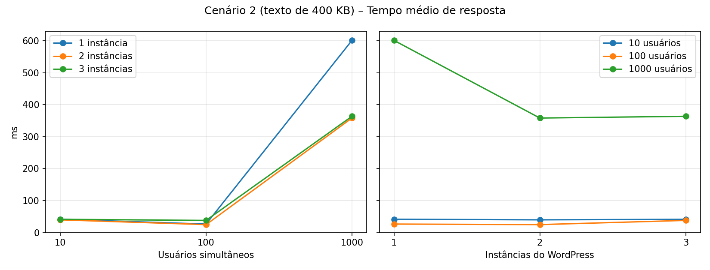

Neste cenário só há o post (sem imagem), então a média é o tempo do próprio post de 400 KB (~470 KB de HTML). Com 10 usuários é de 40 a 42 ms, bem acima dos cenários 1 e 3 (15 ms), onde a média é puxada para baixo pelas imagens, que são rápidas. Com 100 usuários cai para 25 a 27 ms com 1 e 2 instâncias, mas com 3 instâncias fica em 38 ms. Isso não é um valor isolado: a curva de percentis inteira dessa execução está deslocada para cima (mediana de 35 ms contra 23 a 25 ms). Com uma única execução por combinação, não dá para saber se é efeito da arquitetura ou acaso, e não concluímos que 3 instâncias sejam mais lentas. Com 1000 usuários a média vai a 601 ms (1 instância), 358 ms (2) e 364 ms (3); a queda é coerente com mais respostas de erro rápidas (as falhas sobem de 77% para 87%), e não com melhora real.

#### Percentil 95 (p95)

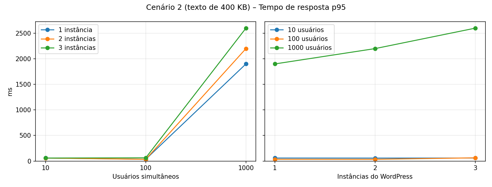

Com 10 usuários o p95 é de 58 a 59 ms. Com 100 usuários é de 34 a 35 ms para 1 e 2 instâncias e de 63 ms para 3 instâncias (a mesma execução deslocada vista no tempo médio). Com 1000 usuários sobe para 1.900 ms (1 instância), 2.200 ms (2) e 2.600 ms (3): os 5% mais lentos esperam de 1,9 a 2,6 s e, como no cenário 1, **mais instâncias pioram** o valor. São os p95 mais altos entre os três cenários com 1000 usuários.

#### Requisições por segundo

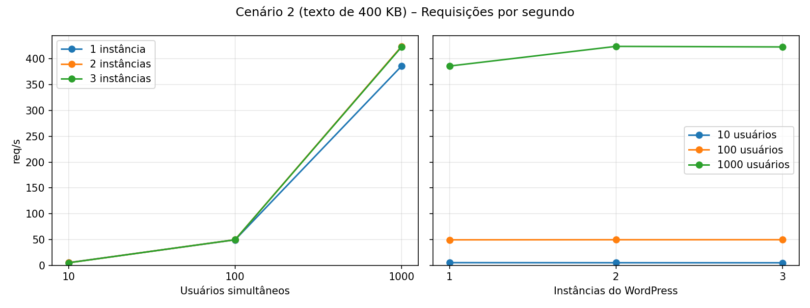

Com 10 usuários a vazão é de ~5 req/s e com 100 usuários, de ~49 req/s: metade dos cenários 1 e 3, porque aqui cada visita faz uma requisição só (o post), e não duas (post e imagem). Com 1000 usuários chega a 386 req/s (1 instância) e a ~424 req/s (2 e 3 instâncias): 10× mais usuários deram só ~8× mais req/s, e passar de 2 para 3 instâncias não alterou a vazão (424 e 423 req/s). É a menor vazão com 1000 usuários entre os cenários (os outros ficam em 494 a 545 req/s), o que vem em parte de cada visita ter uma requisição a menos.

#### Taxa de falhas

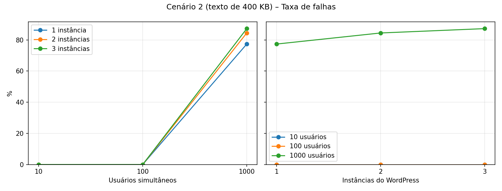

Também não há falhas até 100 usuários. Com 1000 usuários é o cenário com mais falhas: 77,4% (1 instância), 84,5% (2) e 87,3% (3), subindo com as instâncias. Como não há imagem para diluir a taxa, ela é a do próprio post (com 3 instâncias, 22.226 falhas em 25.472 pedidos). São erros `HTTP 500`, e a explicação é a mesma do cenário 1: o limite de 151 conexões do MySQL, compartilhado por todas as instâncias.

#### Distribuição de percentis

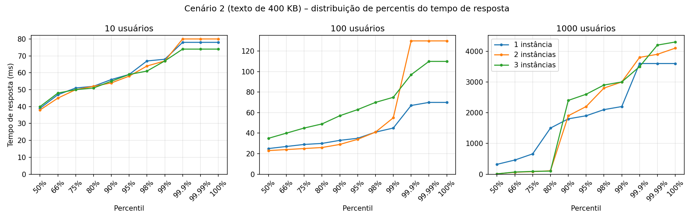

**10 usuários:** a curva é mais alta que no cenário 1 (mediana de 38 a 40 ms, contra 13 ms), porque todas as requisições são do post de 400 KB; 99% das respostas levaram até ~68 ms e o máximo foi de 74 a 80 ms.

**100 usuários:** com 1 e 2 instâncias a curva fica baixa (mediana de 23 a 25 ms, p99 de 45 e 55 ms). Com 3 instâncias toda a curva está deslocada para cima (mediana de 35 ms, p95 de 63 ms, p99 de 75 ms): não é um pico no final, e sim uma execução inteira mais lenta. O percentil 99,9 é o maior com 2 instâncias (130 ms, contra 67 e 97 ms), o mesmo padrão do cenário 1, com poucas requisições envolvidas (~3).

**1000 usuários:** o mesmo degrau do cenário 1. Com 2 e 3 instâncias a mediana é de 10 a 11 ms e o percentil 80 fica em 100 a 110 ms, mas no percentil 90 já são 1.900 a 2.400 ms, com máximos de 4,1 e 4,3 s. Com 1 instância a curva é mais alta desde o início (mediana de 320 ms e percentil 80 em 1.500 ms).

<details>
<summary>Tabela completa</summary>

| Usuários | Instâncias | Requisições | Falhas | Tempo médio (ms) | p95 (ms) | Req/s |
|---:|---:|---:|---:|---:|---:|---:|
| 10 | 1 | 303 | 0,0% | 42 | 59 | 5,1 |
| 10 | 2 | 295 | 0,0% | 40 | 58 | 4,9 |
| 10 | 3 | 290 | 0,0% | 41 | 59 | 4,8 |
| 100 | 1 | 2962 | 0,0% | 27 | 35 | 49,3 |
| 100 | 2 | 2974 | 0,0% | 25 | 34 | 49,5 |
| 100 | 3 | 2978 | 0,0% | 38 | 63 | 49,5 |
| 1000 | 1 | 23239 | 77,4% | 601 | 1900 | 386,1 |
| 1000 | 2 | 25531 | 84,5% | 358 | 2200 | 424,2 |
| 1000 | 3 | 25472 | 87,3% | 364 | 2600 | 423,2 |

</details>

### Cenário 3 – post com imagem de ~300 KB

#### Tempo médio de resposta

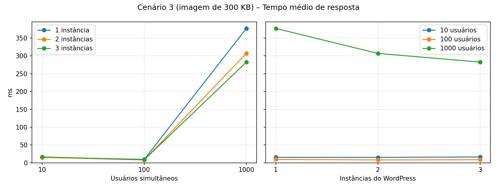

Parecido com o cenário 1: 15 a 16 ms com 10 usuários e 8 a 9 ms com 100 usuários, com as linhas sobrepostas (o número de instâncias não alterou o tempo médio). A média mistura o post (15 a 31 ms) e a imagem de 300 KB (1 a 2 ms). Com 1000 usuários vai a 377, 307 e 283 ms com 1, 2 e 3 instâncias. Aqui a queda **não** acompanha as falhas, que ficaram praticamente iguais (55 a 57%), então não se explica só por respostas de erro rápidas; a causa não foi determinada. O post tem média de 470 ms com 1 instância e 358 ms com 3.

#### Percentil 95 (p95)

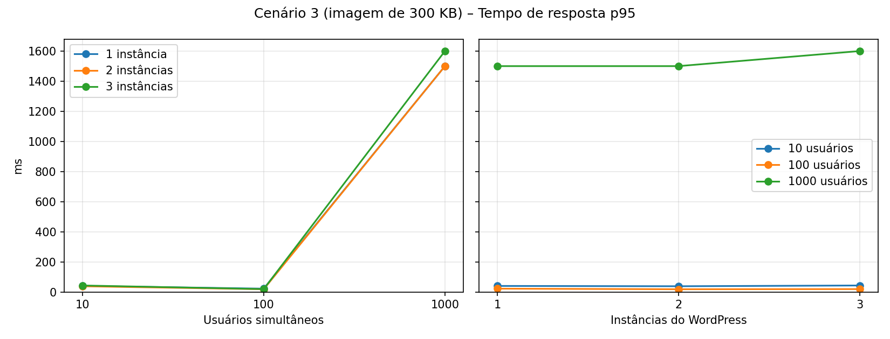

Com 10 usuários o p95 é de 38 a 43 ms e com 100 usuários, de 18 a 22 ms. Com 1000 usuários vai a 1.500 ms (1 e 2 instâncias) e 1.600 ms (3): é o menor p95 entre os cenários nessa carga e quase não muda com as instâncias, ao contrário dos cenários 1 e 2, em que ele piora.

#### Requisições por segundo

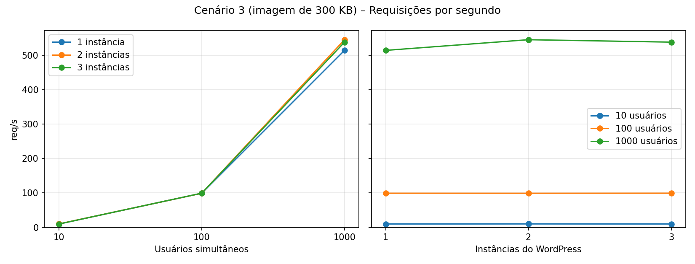

Com 10 e 100 usuários a vazão é de ~10 e ~99 req/s, como no cenário 1. Com 1000 usuários chega a 514 req/s (1 instância), 546 (2) e 539 (3): é a maior vazão entre os cenários nessa carga, mas quase não varia com o número de instâncias (diferença de ~6%), e 10× mais usuários deram só ~5× mais req/s.

#### Taxa de falhas

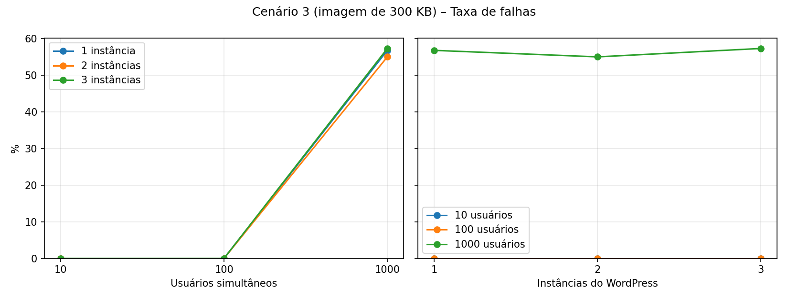

Não há falhas até 100 usuários. Com 1000 usuários a taxa agregada é de 56,8%, 55,0% e 57,3% (1, 2 e 3 instâncias): é a menor entre os cenários com 2 e 3 instâncias e, diferente dos outros, **não aumenta com as instâncias**. Só no post, a falha é de ~72% nas três arquiteturas (72,5%, 71,2% e 72,8%), e as imagens quase não falham (até 4 falhas em ~7.000 pedidos). A causa dos erros `HTTP 500` é a mesma dos outros cenários (limite de conexões do MySQL). Por que este cenário falha menos que o 1 não foi determinado: a diferença está só no tamanho da imagem, que não passa pelo banco, e pode ser acaso de uma execução.

#### Distribuição de percentis

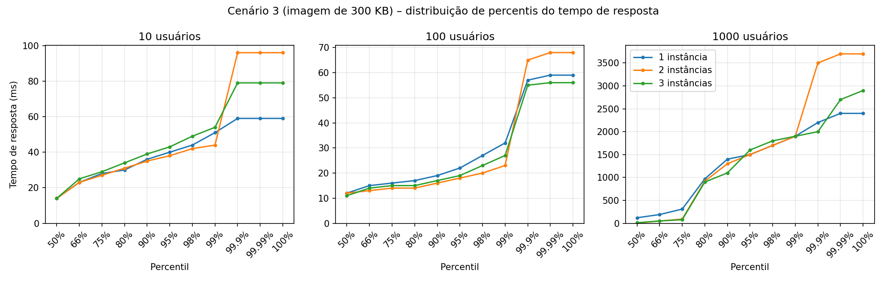

**10 usuários:** curva parecida com a do cenário 1 (mediana de 14 ms, p99 de 44 a 54 ms). O percentil 99,9 da execução com 2 instâncias (96 ms) parece um pico, mas com ~600 requisições esse percentil é praticamente uma única requisição.

**100 usuários:** curvas baixas e próximas (mediana de 11 a 12 ms, p99 de 23 a 32 ms, máximo de 56 a 68 ms). O padrão de percentil 99,9 maior com 2 instâncias é fraco aqui (65 ms contra 57 e 55 ms).

**1000 usuários:** também há degrau, mas ele aparece mais cedo que nos cenários 1 e 2: com 2 e 3 instâncias a mediana é de 6 a 11 ms, porém o percentil 80 já está em ~900 ms (contra ~100 ms nos outros cenários) e o percentil 90 em 1.100 a 1.300 ms. É coerente com este cenário ter menos respostas rápidas (menos falhas), mas isso não foi verificado. Com 1 instância a mediana é de 120 ms. Os máximos ficam entre 2,4 e 3,7 s.

<details>
<summary>Tabela completa</summary>

| Usuários | Instâncias | Requisições | Falhas | Tempo médio (ms) | p95 (ms) | Req/s |
|---:|---:|---:|---:|---:|---:|---:|
| 10 | 1 | 590 | 0,0% | 15 | 40 | 9,8 |
| 10 | 2 | 602 | 0,0% | 15 | 38 | 10,1 |
| 10 | 3 | 588 | 0,0% | 16 | 43 | 9,8 |
| 100 | 1 | 5966 | 0,0% | 9 | 22 | 99,2 |
| 100 | 2 | 5956 | 0,0% | 8 | 18 | 99,1 |
| 100 | 3 | 5966 | 0,0% | 9 | 19 | 99,3 |
| 1000 | 1 | 31086 | 56,8% | 377 | 1500 | 514,5 |
| 1000 | 2 | 32809 | 55,0% | 307 | 1500 | 545,5 |
| 1000 | 3 | 32391 | 57,3% | 283 | 1600 | 538,5 |

</details>

## Análise geral

**Até 100 usuários o sistema não sofre, e o número de instâncias não faz diferença.** Não houve nenhuma falha e o tempo médio ficou entre 8 e 42 ms. As diferenças entre 1, 2 e 3 instâncias são de poucos milissegundos, dentro da variação de uma única execução. A vazão segue o que os usuários geram, e não o que o servidor consegue atender: uma instância já dá conta dessa carga.

**O cenário 2 (texto de 400 KB) é o mais lento por requisição.** Com 10 e 100 usuários a mediana do post de texto é de 23 a 40 ms, contra 11 a 14 ms nos cenários 1 e 3, onde metade das requisições são imagens de ~2 ms. Entre as imagens de 1 MB e 300 KB a diferença é mínima (2 a 3 ms contra 1 a 2 ms), porque o tráfego é local, sem rede real. O custo está em gerar a página (PHP + banco), não em transferir o arquivo.

**Com 1000 usuários o sistema falha, e adicionar instâncias não resolve.** As falhas ficaram entre 55% e 87% e o p95 subiu para 1,5 a 2,6 s. A taxa de falhas **não diminuiu** com mais instâncias em nenhum cenário.

**A causa identificada é o limite de conexões do MySQL, compartilhado por todas as instâncias.**

- Quase todas as falhas são `HTTP 500` no **post**. As imagens são servidas direto do disco pelo Apache e não usam o banco, e quase não falham.
- O MySQL está com `max_connections = 151` (padrão). Depois da execução com 3 instâncias ele registrava `Connection_errors_max_connections = 19.121` e `Max_used_connections = 152`: o limite foi atingido e conexões foram recusadas.
- O log do Apache também registrou `server reached MaxRequestWorkers` (limite padrão de 150 processos por instância).
- Mais instâncias significam mais processos tentando abrir conexões contra o **mesmo** limite do banco.

O **tempo médio** com 1000 usuários mistura respostas de erro, que são rápidas, com respostas bem-sucedidas, que são lentas. Por isso o p95 e a distribuição de percentis descrevem melhor o que o usuário sente.

## Limitações

- **Uma execução por combinação**: não há repetição nem medida de variação. Diferenças de poucos milissegundos não devem ser lidas como ganho ou perda reais.
- **Tudo na mesma máquina**: o Locust compete por CPU com o Nginx, o WordPress e o MySQL, e o tráfego é local, sem latência de rede.
- **MySQL emulado**: a imagem `mysql:5.7` não tem versão ARM e roda como `linux/amd64` com emulação no Apple M5, o que pode torná-lo mais lento do que num servidor x86.
- **VM do Docker**: 10 CPUs e ~7,75 GiB de memória, compartilhados por todos os contêineres.
- **Conteúdo sintético**: as imagens são ruído aleatório e o texto é "lorem ipsum" repetido.
- **Métricas agregadas**: os tempos usam a linha `Aggregated` (post + imagem). Os CSVs em `results/` também têm as linhas separadas `post` e `imagem`.

## Conclusão

A camada da aplicação escala horizontalmente: o Nginx distribui as requisições por Round Robin entre as réplicas do WordPress, e o número de instâncias é configurável com `--scale`. Mas o desempenho total é limitado pelo componente compartilhado, o banco de dados. Nos três cenários, escalar o WordPress de 1 para 3 instâncias não trouxe ganho mensurável, e a carga de 1000 usuários mediu o limite de conexões do MySQL, e não o ganho de ter mais instâncias. Melhorias possíveis, não testadas aqui: aumentar `max_connections` do MySQL, usar cache de página ou de objetos e usar réplicas de leitura.
